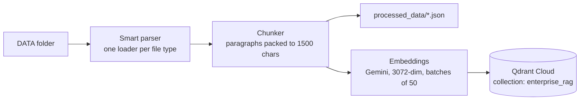

# Kubernetes Agentic RAG

An enterprise-style Retrieval-Augmented Generation (RAG) assistant that answers Kubernetes questions from a small set of internal-style documents, while a large set of unrelated "noisy" documents sits in the same index to test whether retrieval can ignore them.

> **Status: work in progress.** The ingestion pipeline is built and verified. Retrieval, the agent, the API and everything after it are not built yet; see [Roadmap](#roadmap).

Built while following Krish Naik's *Build Enterprise-Grade RAG Applications* live marathon ([video](https://youtu.be/bjkjaqUZl4E)). Every file is typed and debugged by hand; the course code ([d-hackmt/8hr-MARATHON](https://github.com/d-hackmt/8hr-MARATHON)) is used only as a reference when stuck.

## How ingestion works



| Step | Code | What it does |
|---|---|---|
| Parse | `app/ingestion/loaders/` | PDF via pypdf, with pdfplumber for pages pypdf returns blank (page order preserved); HTML via BeautifulSoup (scripts/styles removed); DOCX/PPTX via `unstructured`; TXT read as is |
| Chunk | `app/ingestion/chunking/splitter.py` | Splits on blank lines and packs paragraphs into chunks of up to 1500 characters |
| Embed | `app/services/retrieval/embedding.py` | Gemini embeddings in batches of 50, exponential backoff on rate limits, local `all-mpnet-base-v2` fallback |
| Index | `app/ingestion/processor.py` | Creates the Qdrant collection (cosine, dimension taken from the active model), upserts one point per chunk with `text`, `source` and `source_type` (`true` / `noisy`) in the payload |

Every step is traced with [Pydantic Logfire](https://logfire.pydantic.dev) spans: one trace per run, one span per file, one span per embedding batch.

## Data

| Folder | Contents | Role |
|---|---|---|
| `DATA/true_data/` | 6 Kubernetes documents (pptx, docx, html, txt) | The knowledge base the assistant should answer from |
| `DATA/noisy_data/` | 58 unrelated technical documents (mostly PDFs) | Distractor pool |
| `DATA/noisy_sample_10/` | 10 files from the pool | The distractor set used for the first retrieval tests |

Every chunk is labelled `true` or `noisy` at ingestion. That lets retrieval quality be measured directly: count how many noisy chunks reach the top-k for a set of Kubernetes questions, before and after reranking.

## Setup

Requires Python 3.13 and [uv](https://docs.astral.sh/uv/).

```bash
uv venv --python 3.13
.venv\Scripts\Activate.ps1          # Windows PowerShell; on macOS/Linux: source .venv/bin/activate
uv pip install -r requirements.txt
```

Create a `.env` file in the project root (never commit it):

```
GEMINI_API_KEY=
QDRANT_CLUSTER_ENDPOINT=
QDRANT_API_KEY=
GROQ_API_KEY=
GROQ_FALLBACK_API_KEY=
LOGFIRE_TOKEN=
LOGFIRE_SEND_TO_LOGFIRE=if-token-present
```

## Running ingestion

```bash
# Clean data, starting from an empty collection
python -m app.ingestion.processor DATA/true_data true --wipe

# Add distractors on top (no --wipe, or the clean data is deleted)
python -m app.ingestion.processor DATA/noisy_sample_10 noisy
```

Only `--wipe` deletes the collection. Point ids are random, so re-running a folder without `--wipe` duplicates its points.

**Verified result:** `true_data` → 70 points (13 + 37 + 1 + 14 + 4 + 1), vector size 3072, matching the chunk counts in `processed_data/true/`.

## Problems hit so far, and fixes

| Symptom | Cause | Fix |
|---|---|---|
| DOCX/PPTX parsing hangs forever on Windows | `unstructured` imports `python-magic`, which tries to load libmagic, a Linux/macOS library | `uv pip uninstall python-magic`; `unstructured` falls back to the `filetype` package |
| `No Logfire project credentials found`, crash at startup | `logfire.configure()` with no token tries to create a project interactively | Set `LOGFIRE_TOKEN` (write token), or `LOGFIRE_SEND_TO_LOGFIRE=false` for local runs |
| `The write operation timed out` on larger files | Qdrant client default timeout is 5 s; 3072-dim vectors are about 60 KB each as JSON | `QdrantClient(..., timeout=60)` |
| Several noisy files failed in a row, then later ones succeeded | Gemini tokens-per-minute limit; the original backoff (1 + 2 + 4 s) was shorter than the 60 s quota window | Longer backoff, capped at 60 s |
| `sentence-transformers` fails to import (`pyarrow has no attribute PyExtensionType`) | Unpinned requirements resolved an old `datasets` against a new `pyarrow` | Open: pin versions |
| HTML files produce one huge chunk each | The HTML loader joins lines with `\n`, the splitter only cuts on `\n\n` | Open |

## Roadmap

- [x] Loaders, chunking, embeddings, Qdrant indexing, tracing
- [x] Clean data ingested and verified
- [ ] Noisy sample ingested and verified
- [ ] Retrieval: Qdrant search + FlashRank cross-encoder reranking; noisy-chunks-in-top-k before vs after
- [ ] LangGraph agent: planner (conversational vs technical) → retriever → responder (Groq, Llama 3.3 70B)
- [ ] FastAPI backend + Streamlit UI
- [ ] NeMo Guardrails before retrieval; Portkey gateway with fallback and caching
- [ ] RAGAS evaluation on a hand-written golden set
- [ ] Docker + AWS ECS Fargate deployment
- [ ] Incremental ingestion (deterministic chunk ids, per-file manifest)

## Project layout

```
app/
  config.py                     settings loaded from .env
  ingestion/
    loaders/                    pdf.py, html.py, office.py, text.py
    chunking/splitter.py        paragraph chunker
    processor.py                ingestion entry point (parse -> chunk -> embed -> index)
  services/retrieval/
    embedding.py                Gemini embeddings + fallback
DATA/                           true_data, noisy_data, noisy_sample_10
processed_data/                 parsed chunks per file (generated)
usefulCommands.md               ingestion commands from the course notes
```
